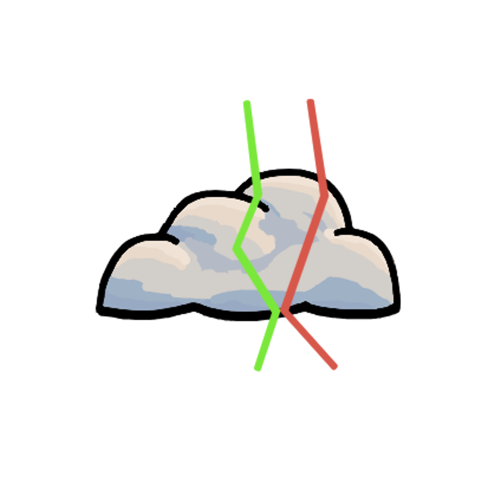
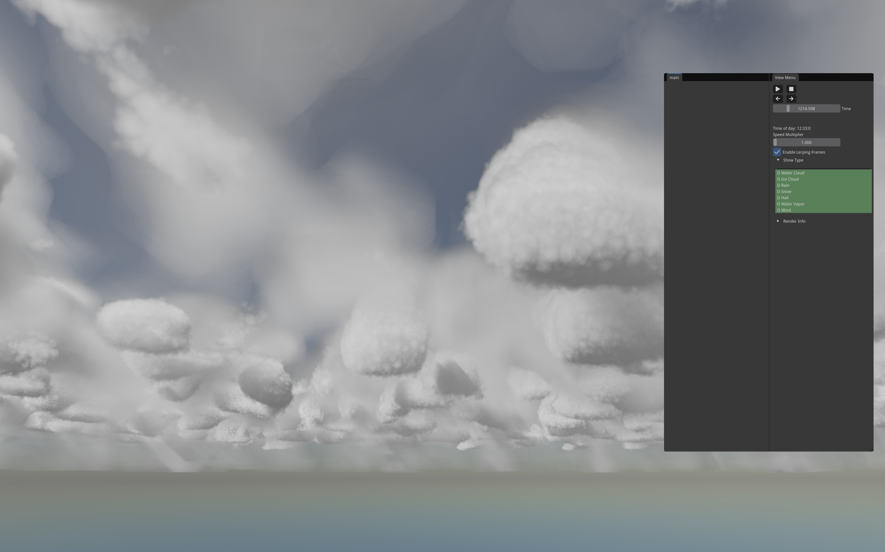
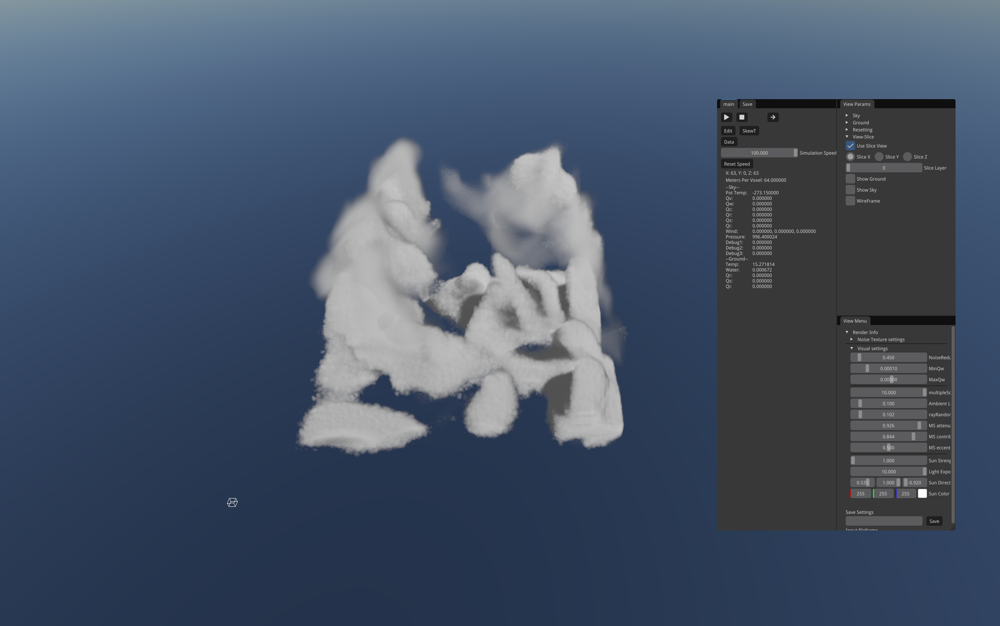
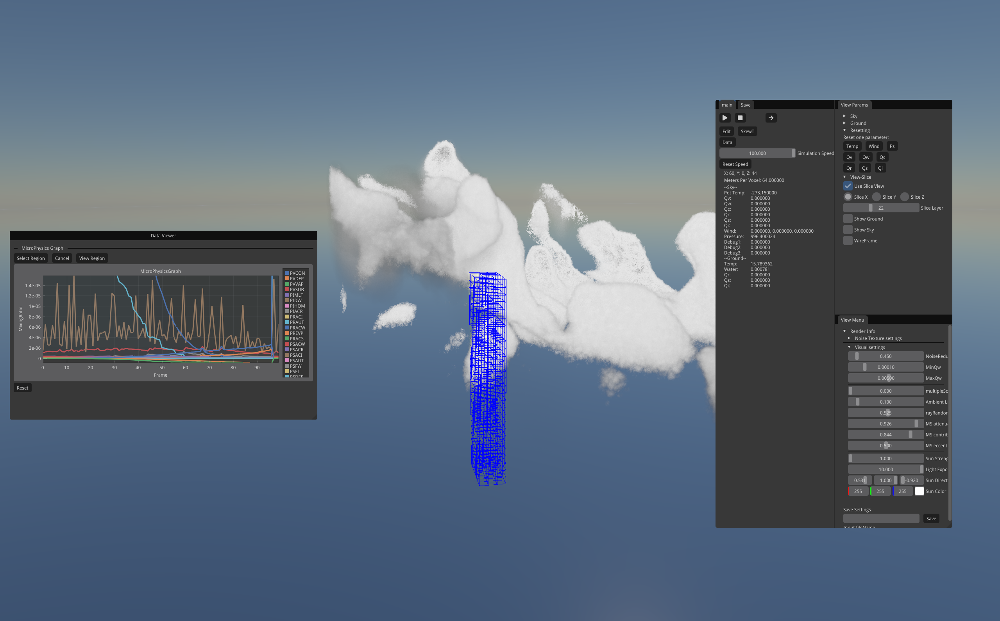
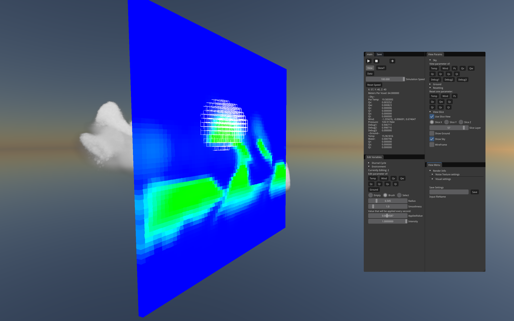

# CloudWeatherSim

 

 

## Downloads

Choose between your current GPU (NVIDIA or AMD) to get the supported .exe file.

<!--Radio buttons to decide which download to pick-->

    <!--NVIDIA-->
    <input type="radio" id="NVIDIA" name="version" value="NVIDIA" checked>
    <label for="NVIDIA">NVIDIA</label>
    <!--AMD-->
    <input type="radio" id="AMD" name="version" value="AMD">
    <label for="AMD">AMD</label>

    
Download for NVIDIA devices: 

    <a class="download_btn" href="{{ '/assets/media/ProgramCloudWeatherSim/Executables/CloudWeatherSimNVIDIA_V0.1.zip' | relative_url }}" download> ↓ Download cloudWeatherSimNVIDIA_V0.1.zip ↓ </a>

    
Download for AMD devices: 

    <a class="download_btn" href="{{ '/assets/media/ProgramCloudWeatherSim/Executables/CloudWeatherSimAMD_V0.1.zip' | relative_url }}" download> ↓ Download cloudWeatherSimAMD_V0.1.zip ↓ </a>

Simply download the file, extract the zip file and launch the .exe

### Compiling the source code

If you want to use this library for your own code base, compile the source code on your own via the github:  
[https://github.com/finntie/skewTCloudSim](https://github.com/finntie/skewTCloudSim).  
This does require extra tools to be installed. 

### Supported Hardware and Software

**Windows**  
The current AMD and NVIDIA builds have been tested on a Windows device only, on a NVIDIA RTX 5700.  

**Linux**  
Linux is currently not supported as it has not been tested yet but is planned for the future.  

**<strong style="color:black;"><u>NVIDIA</u></strong>**  
NVIDIA is supported, as it uses CUDA code (Hipified for AMD support).  

Compute Capabilities: 
- 75 
- 86 
- 89 
- 120 

This includes the following GPUs
- The NVIDIA RTX PRO series
- GeForce RTX 2000, 3000, 4000 and 5000 series
- QUADRO RTX series
- NVIDIA RTX series

If not sure if your GPU is includes, compare it on the NVIDIA site:
https://developer.nvidia.com/cuda/gpus (compute capability 12.0 = 120)

**<strong style="color:black;"><u>AMD</u></strong>**  
AMD is supported due to the use of HIP.  
The build is tested with HIP SDK 6, make sure your driver supports amdhip64_6.dll, if it supports amdhip64_7.dll, the build needs to be compiled with HIP SDK 7. Versions lower than 6 are not tested. 

| GFX target | Example GPU | Status |
|---|---|---|
| gfx1010 | RX 5700 | Tested, not officially supported by AMD |
| gfx1030 | RX 6800 | Untested |
| gfx1031 | RX 6700 | Tested |
| gfx1032 | RX 6600 | Untested |
| gfx1100 | RX 7900 | Untested |
| gfx1101 | RX 7800/7700 | Untested |
| gfx1102 | RX 7600 | Untested,  Possibly not supported with HIP SDK 6|
| gfx1200 / gfx1201 | RX 9060 / 9070 | Untested,  Possibly not supported with HIP SDK 6 |

Most GPUs are not tested, yet cards with the same gfx target as listed should work. If your GPU was not listed or you are not sure, check if your GPU corresponds to any listed gfx version.  

**Warning**  
Only few GPUs are tested, if the library does not run on your hardware, make sure to report this so it can be looked into and hopefully be supported soon.

  

## Version 0.1

The current version is 0.1, this is the beta release version of the library. 

### Features

Current features include:
- Creating environments from drawing skew-T diagrams
- Loading environments from observed soundings, supported are KNMI and DWD files. These can be put in assets->input->DWD or KNMI
- Simulating the environment from 1 to 100 times the normal speed
- Viewing all parameters using the debug viewer
- Editing the simulation by brushing or selecting with the selected parameter
- Viewing a skew-T diagram from a voxel upwards when pressing space on a voxel
- With the data graph, select a region of voxels in which it will track all phase changes and write them on a graph
- Saving the simulation by recording frames and saving them on disk
- Loading simulation that were saved in assets->output
- Changing render settings on the go (some settings will make the renderer very slow)

### Bugs

- When finishing temperature and dewpoint of the skew-T diagram and going into the hodograph, the cursor might not be there.
- The current simulation is not fail proof, there is always a small chance of your simulation crashing, especially at high velocity values.  
    If this continues to happen, make sure to report this.
- You can confirm an environment that you have not finished creating, this creates a corrupt environment, you will have to restart the program to reset.
- When going under the ground, zooming in or out will be reversed and may cause some confusion (press CRTL + R to reset cam position and rotation).
- Debug view and clouds are not correctly synced up.

If you come across other bugs and issues, make sure to report these issues by sending a message on **[X](https://x.com/Finntie2)** or via **discord** (finnie_1). 

### Other Limitations

- As the clouds are post-processing, it is not possible to show the clouds in any reflective objects you draw.

- The shadows from clouds do not take into account blocking of other geometry, making the underside of object also have shadows from clouds. 

- Not all input files for observed soundings are supported, KNMI and DWD only for now, and DWD only zip files that include metadata.

- The current version uses **one** resolution and gridsize only, this will in the future made changable before creating a simulation.

- With good render settings, the fps can get very low, especially when up close to rain/snow together with clouds.

- The simulation is based inside a gridfield, this grid is likely about 64x64x64 big. On the edges of this simulation, clouds may behave differently due to the boundary conditions.

  

## Using the Program

Inside the program, there are multiple options to choose from.  
It is mainly split up in 2 catergories: **Simulating** and **Viewing**.

### Simulating

Simulating clouds requires a starting position; a blanc environment can mean many things, depending on the temperature, moist and wind speed, many different scenarios can unfold.  
There are multiple options of how to decide your starting environment:  
1. **Create your own from scratch**  
    Use the Skew-T editor to decide the temperature and dew point for each height in the environment. Use the hodograph to set the wind speed.  
    This requires knowledge on [Skew-T diagrams](https://www.weather.gov/source/zhu/ZHU_Training_Page/convective_parameters/skewt/skewtinfo.html) which could be difficult to start with.
2. **Use observed soundings**  
    Every day, countries will send out weather balloons up high to measure the environment. You may use this data to try and simulate the weather of that day.  
    *(Note: weather will never be 1-to-1 of the observed day, due to so limitations and many factors uncounted for in the simulation)*.  
3. **Load user-created soundings**  
    Load environments that you made or someone else made.  
    (**Coming soon:** default environments for easy and interesting pre-set scenarios).

Now that an environment is loaded, you may start playing it by pressing the play button.  
The simulation pace is based on real time, meaning it is pretty slow, put the simulation speed between 1 and 100 to see results way quicker.  

Play around with all the features there are to be seen, for example the saving (recording), visualizing the environment using the debug viewer or edit the simulation with the editor.  

### Rendering

Visualize some of the simulations you or someone else has made.  
When using the cloud viewer, you can look through the saved simulations, viewing them from the first until the last frame.  
You can play with the render settings to change the look of the clouds.  

 

## Tutorial

<video width="800" style="margin: 20px 20px 20px 20px;" controls>
<source src="../../assets/media/ProgramCloudWeatherSim/TutorialBeta.mp4" type="video/mp4">
</video>

